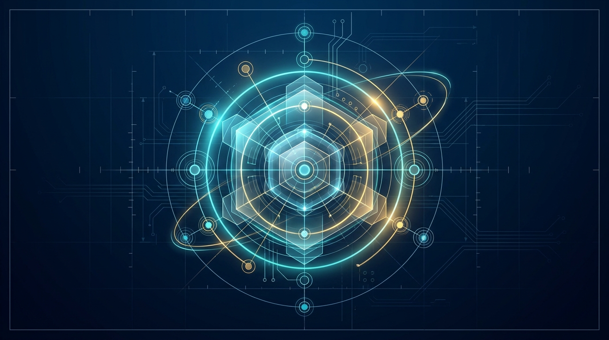

# Agent Design Patterns Playbook



A hands-on, runnable repository demonstrating **15 AI Agent Design Patterns** using **Anthropic Claude**, **LangGraph**, and **Arize Phoenix** — built as the companion codebase to the LinkedIn article [`LINKEDIN_ARTICLE.md`](LINKEDIN_ARTICLE.md).

## The 15 Patterns Implemented

### Start Simple, Think in Steps
1. **`01_single_agent`** – Single-Agent System: Internal IT helpdesk agent with KB search and ticket creation.
2. **`02_react`** – ReAct (Reason + Act): Support agent investigating a delayed order via iterative tool calls.
3. **`03_plan_and_execute`** – Plan-and-Execute: Research agent that creates an explicit 4-step competitor briefing plan before executing.

### Control the Flow
4. **`04_sequential`** – Sequential (Prompt Chaining): 4-stage product launch content pipeline (extract → draft → brand voice → fact-check).
5. **`05_parallel`** – Parallel: Travel agent searching flights, hotels, and local transport simultaneously (fan-out / fan-in).
6. **`06_loop`** – Loop: Coding agent writing a function, running unit tests, and retrying on failure (bounded to 3 attempts).

### Route It, Coordinate It, Break It Down
7. **`07_routing`** – Routing: Customer service classifier routing to Billing, Technical Support, or Human Retention.
8. **`08_coordinator`** – Coordinator (Orchestrator-Workers): Market-research orchestrator delegating sizing, competitors, and customer insights.
9. **`09_hierarchical`** – Hierarchical Task Decomposition: Enterprise Day-1 onboarding across IT, HR, and Facilities sub-teams.

### Many Minds, Checked Work
10. **`10_swarm`** – Swarm (Multi-Agent Collaboration): Peer-to-peer incident-response swarm (Detection → Diagnostics → Remediation → Comms).
11. **`11_review_and_critique`** – Review and Critique (Evaluator-Optimizer): Proposal writer paired with a strict deal-desk critic.
12. **`12_iterative_refinement`** – Iterative Refinement (Reflection): LinkedIn post agent self-critiquing and polishing its own draft.
15. **`15_elephant_goldfish`** – Elephant-Goldfish Model: Context-rich Elephant drafter paired with a stateless, cold-read Goldfish spec reviewer (inspired by [egm.dev](https://egm.dev/)).

### Grounding and Safety
13. **`13_tool_use_and_rag`** – Tool Use and RAG (The Grounded Agent): Finance & policy assistant combining live balances, policy RAG, and deterministic math.
14. **`14_human_in_the_loop`** – Human-in-the-Loop: Sales outreach agent pausing at a LangGraph `interrupt_before` checkpoint for human approval.

## Tech Stack
- **LLM:** Anthropic Claude Haiku (`claude-haiku-4-5`, configurable via `ANTHROPIC_MODEL`)
- **Orchestration:** LangGraph (`StateGraph`, `create_react_agent`, `MemorySaver` checkpoints)
- **Observability:** Arize Phoenix + OpenInference (`shared/observability.py`)
- **CLI & Benchmarking:** `uv`, `rich`, and `shared/eval.py`

## Quick Start
```bash
# 1. Install dependencies
uv sync

# 2. Configure environment
cp .env.example .env
# Add your ANTHROPIC_API_KEY to .env

# 3. Run any single pattern
uv run python 01_single_agent/app.py
uv run python 13_tool_use_and_rag/app.py
uv run python 14_human_in_the_loop/app.py

# 4. Run the full 14-pattern benchmark (writes benchmarks/results.md)
uv run python shared/eval.py

# 5. (Optional) Enable Arize Phoenix tracing
ENABLE_PHOENIX=true uv run python shared/eval.py
```

## LinkedIn Article
The complete, ready-to-publish LinkedIn article is in [`LINKEDIN_ARTICLE.md`](LINKEDIN_ARTICLE.md), paired with the widescreen cover image [`linkedin_banner.jpg`](linkedin_banner.jpg).
